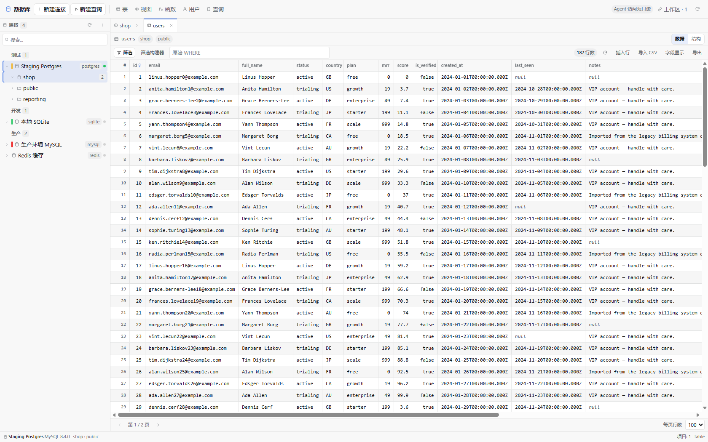
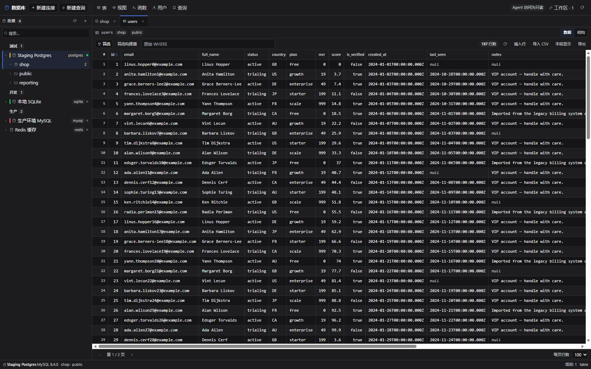
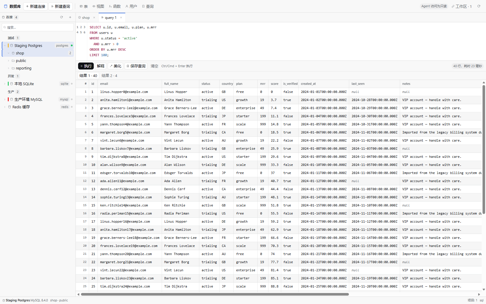
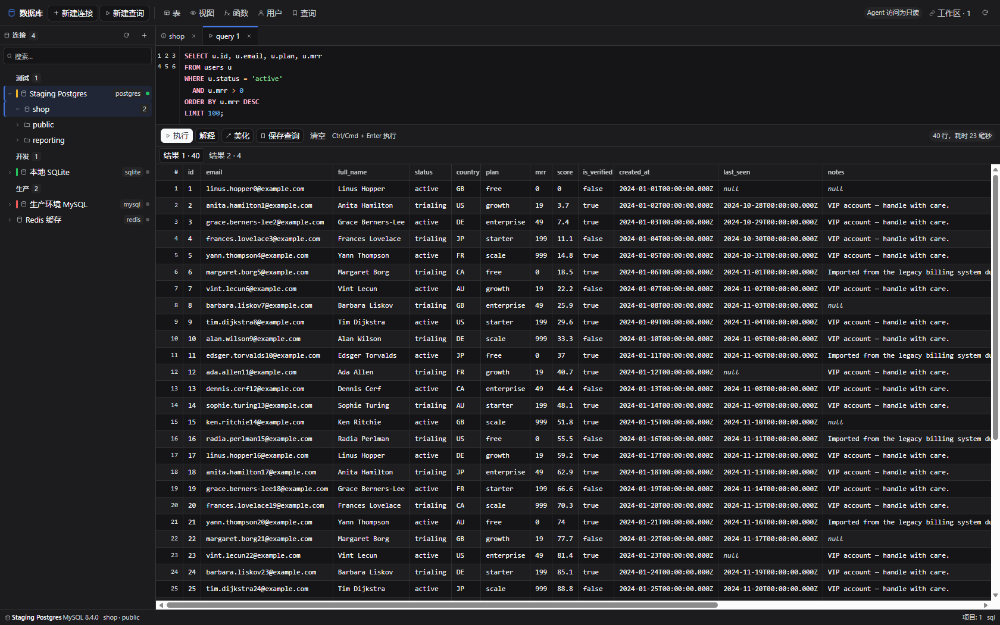
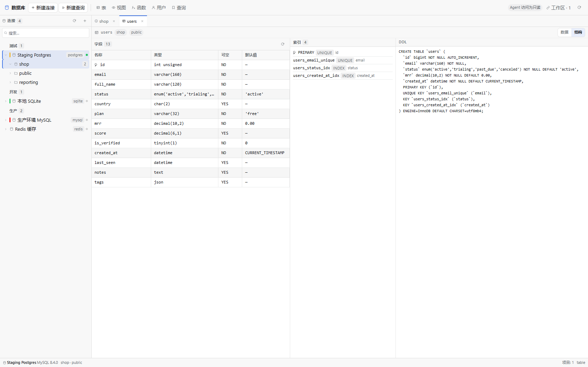
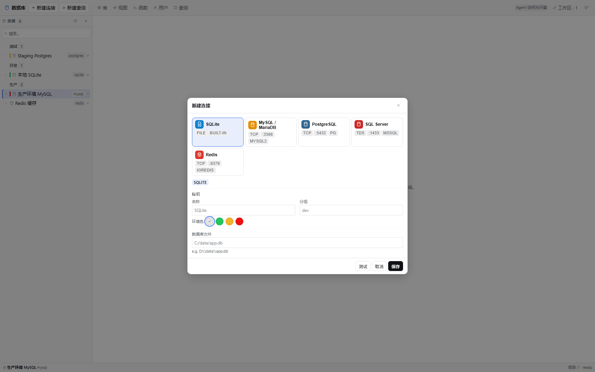

# Grid — database workbench for DeepSeek Harness

Grid connects to your databases and works like a desktop client: a connection tree, an object list,
an editable data grid, a highlighted SQL console, and a Redis browser. It is modelled on
[RustGrid](https://github.com/yisier/rustgrid) — the Navicat-style layout, the object list with
metadata, the Excel-style data grid, the SQL editor with completion.

The difference is that Grid is also an agent capability: the connections you configure are exposed
as `grid_*` tools, so the model can inspect a schema and query it without you copying results around.

Upgrading from 0.4.0? Read [CHANGELOG.md](CHANGELOG.md) first — TLS verification, retry policy and the
`rows` response shape all changed.

## Screenshots

Both themes are rendered from the same declarations — a `--dg-*` layer over the host tokens — so dark
mode is not a separate skin that drifts.

| Light | Dark |
| --- | --- |
|  |  |

The SQL console takes its syntax colours from the host's own highlighter palette, pulled toward the
text colour so strings and comments stay readable on white as well as on near-black:

| Light | Dark |
| --- | --- |
|  |  |

| Structure of a relation | New connection |
| --- | --- |
|  |  |

These are produced by `dev/cdp-shot.mjs` (see [Development](#development)); `pnpm audit:ui` measures
the same views for contrast, surface separation and target sizes instead of photographing them.

## Install

```powershell
dsh plugin add D:\work\code\dsh-grid-plugin
```

Or from the Plugin Manager: **Install bundle** → choose this directory. Then reload the page and
open the **数据库 / Grid** entry in the sidebar.

To let the agent modify data, edit the row in your profile's `cordis.patch.yml`:

```yaml
- insert:
    - id: grid
      name: '@local/dsh-grid'
      config:
        allowWrites: true    # default false
        idleMinutes: 10      # close an idle session after N minutes
```

`allowWrites` gates the **agent's** `grid_execute` tool. The panel itself always
lets you edit rows (it is you), while `grid_query` is read-only for the agent
regardless.

## Requirements

Node **22.13+** (or 23.4+) is required: SQLite goes through the built-in
`node:sqlite` module, which only stopped needing `--experimental-sqlite` at those
versions. The other four engines are optional dependencies, so a profile that
does without them still starts.

## Engines

| Engine | Driver | Status | Notes |
| --- | --- | --- | --- |
| SQLite | `node:sqlite` (built in) | ✅ out of the box | No install, no native build; queries run on a worker thread |
| MySQL / MariaDB | `mysql2` | ✅ optional dependency | 5.7+; table comments and row estimates |
| PostgreSQL | `pg` | ✅ optional dependency | 12+; database + schema levels, `reltuples` estimates |
| SQL Server | `mssql` | ✅ optional dependency | 2017+ |
| Redis | `ioredis` | ✅ optional dependency | 6+; namespaces, TTL, rename, console |
| Oracle, DB2 / ODBC | — | ⛔ not yet | Needs Instant Client / ODBC |

The four network drivers are declared as `optionalDependencies` and imported lazily. If one is
missing, only that engine reports *"the MySQL driver is not installed"*; everything else keeps
working. Install it with `pnpm add mysql2` inside the plugin directory.

## The panel

Three columns, the way a desktop client is laid out:

```
┌ toolbar ───────────────────────────────────────────────────────────────┐
│ Grid  [+ New] │ ● 生产环境 MySQL  mysql │ ⏻ ✓ ✎ 🗑 │      [New query] [⟳] │
├────────────┬──────────────┬────────────────────────────────────────────┤
│ 连接        │ 对象          │ tabs: users · Query 1 · Redis db0          │
│ ▾ 生产      │ audit_log    │ ┌────────────────────────────────────────┐ │
│   ● MySQL  │ categories   │ │ data grid / SQL console / structure    │ │
│   ○ Redis  │ orders       │ └────────────────────────────────────────┘ │
│ ▸ 测试      │ users        │                                            │
├────────────┴──────────────┴────────────────────────────────────────────┤
│ ● 生产环境 MySQL  8.4.0 · shop · 13 objects                    ready     │
└────────────────────────────────────────────────────────────────────────┘
```

**Connections** — create, edit, delete, test, connect, disconnect; group label, environment colour,
TLS mode. Groups collapse; right-click a connection for the full menu.

**TLS modes** — `disable` (default), `require` (encrypted, certificate *not* verified — use it only
for a host with a self-signed certificate), `verify-ca` (chain verified) and `verify-full` (chain and
host name). A connection created with the old `ssl: true` flag is treated as `verify-full`; supply
`options.sslCa` with a PEM string to trust a private CA.

**Object list** — the relations of the selected database with **name, kind, estimated rows and
comment**, sortable by any column and searchable. Double-click opens a tab; right-click offers
data, structure, "open in query" and copy-name.

**Data grid**

- server-side pagination and click-to-sort that stays correct across pages;
- the pager shows the row total from the engine's own estimate (`≈`) for an unfiltered table, and
  counts exactly when you filter or press **Refresh** — a `COUNT(*)` over a large table costs more
  than the page it labels;
- **Excel-style selection**: click, drag, or `Shift`+arrows to extend; `Ctrl/Cmd+C` copies the
  selection as TSV, `Ctrl/Cmd+V` pastes it back (multi-row paste asks for confirmation);
- the pager shows **selection size, sum and average** of the selected numeric cells;
- double-click a cell to edit it in place; the **row-number cell** opens a row editor with every field at
  once (only the fields you changed are written back, one `UPDATE` by primary key; text, JSON and long
  `varchar` columns get a multi-line field); **Insert row** adds a row of column defaults, ready to fill
  in, and the trash button deletes the current row;
- **column resize** by dragging header edges, **column hide/show** from the Columns menu (local, no
  refetch);
- a **filter builder** (column / operator / value with AND-OR, plus a raw `WHERE` escape hatch);
- insert row, delete row, and an **Export** menu — CSV, JSON, `INSERT` statements, or a Markdown table.
  The export walks the whole table page by page and says so when it stops at the 10 000-row limit.
- **Import CSV** — the header must name columns this table has (a stray column is refused rather than
  dropped). Rows go in 200 at a time and each batch is one transaction, so a bad row leaves nothing
  behind. An empty cell is written as `NULL`, letting the column's own default apply.

Editing needs a primary key: without one a row cannot be addressed safely, so the grid says so and
refuses the edit instead of risking a full-table update.

**Structure** — columns with type, nullability, default and PK marker; indexes; DDL. The description is
fetched once per open table and shared with the data view, so toggling Data/Structure costs no round
trip; each view's Refresh asks for a new one. On PostgreSQL the DDL is assembled from the catalogue —
real types, identity and generated columns, constraints as separate `ALTER TABLE` statements (so a
deferrable constraint survives), non-constraint indexes and comments; on SQL Server the `sys.*`
equivalents including computed columns and named default constraints, rendered with the exact type
(`nvarchar(100)`, `decimal(18, 2)`, `nvarchar(max)`). A view shows its own definition instead of a
synthesised `CREATE TABLE`.

**SQL console**

- **syntax highlighting** (keywords, functions, strings, numbers, comments, variables) drawn under a
  transparent textarea, with a **line-number gutter**;
- **completion** for keywords, functions, the tables in the current database and the columns of the
  open tab; `Ctrl+Space` opens it, arrows navigate, `Enter`/`Tab` accepts;
- `Ctrl/Cmd+Enter` runs the selection or the whole script; `Tab` indents; **Beautify** reformats
  clause by clause; **Explain** prefixes the first statement;
- while a script runs, **Cancel** asks the engine to stop it (PostgreSQL `pg_cancel_backend`, MySQL
  `KILL QUERY`, SQL Server request cancel). SQLite has no interrupt API, and says so instead;
- one result tab per statement, per-statement timing, a 25-entry **history** menu, and a banner when
  the result was capped at 2 000 rows.

**Redis** — namespace-grouped keys (`user:`, `cart:`, …), type filter, per-type value views
(string / hash / list / set / zset / stream), TTL, rename, edit string value, new key, delete, and a
raw command console.

The layout is a flex column and both toolbars **wrap** rather than clip: on a narrow panel the buttons
move to a second line instead of disappearing past the right edge. Measured with
`node dev/cdp-shot.mjs --view table` at 1680 / 1024 / 700 px: no horizontal overflow and no clipped
toolbar control at any of them (at 700 px the toolbar grows to 67 px, two lines).

## Agent tools

| Tool | Purpose | Writes |
| --- | --- | --- |
| `grid_list_connections` | Connections, engines, open sessions (no passwords) | — |
| `grid_inspect` | Databases / schemas / tables, or one table's columns, indexes and DDL | — |
| `grid_query` | Read-only SQL (`SELECT`, `WITH … SELECT`, `SHOW`, `DESCRIBE`, `EXPLAIN`, `PRAGMA`) | no |
| `grid_execute` | Any SQL, including DDL/DML | only with `allowWrites: true` |

`grid_query` classifies every statement before running it and rejects a script containing a mutating
verb, so a read-only request cannot quietly write. The classifier masks string literals and comments
first, refuses `EXPLAIN ANALYZE` (which executes its statement), `SELECT … INTO` / `INTO OUTFILE`,
`FOR UPDATE` / `FOR SHARE`, and a `PRAGMA name = value` assignment.

That is only the first layer. A read-only run is also handed to the engine, which refuses the write
itself: PostgreSQL runs it in `BEGIN READ ONLY`, MySQL in `START TRANSACTION READ ONLY`, and SQLite
sets `PRAGMA query_only`. SQL Server has no read-only session or transaction, so there the classifier
and the login's own permissions are the boundary.

`grid_query` and `grid_inspect` may omit `connectionId` when the workspace is bound to a database in
the panel — the binding supplies both the connection and its database.

## Sessions

A connection keeps **two**: the workbench lane serves the object tree, a page of rows and the
structure view, while SQL you type (and an export) runs on a second lane of its own. A report that
takes thirty seconds no longer freezes the rest of the panel, and Cancel has a connection it can
reach. SQLite and SQL Server stay on one connection — SQLite's driver is synchronous, and `mssql`
already multiplexes its own pool. Sessions expire after `idleMinutes` (default 10).

## Data and security

- Connections live in `$DSH_HOME/dsh-grid/connections.json`.
- Passwords are sealed with **AES-256-GCM** under a random key in `$DSH_HOME/dsh-grid/key`
  (mode `0600`), stored in its own file beside the registry.
- A password is **never** returned to the browser or to a tool: projections carry only
  `hasPassword`.
- The browser talks to `POST /api/grid` through `ctx.connection.fetch`, authenticated by the
  same-origin browser peer.
- Row updates and deletes always require a primary key, so a misclick cannot rewrite a table.
- TLS verifies the server certificate by default; `require` is the explicit opt-out, and it is
  labelled as unverified in the connection form.
- Connection handshakes are bounded (5s at the driver, 20s in the session pool), so an unreachable
  host reports an error instead of spinning.
- Statements are bounded too: `options.queryTimeoutMs` (default 30 000) becomes
  `statement_timeout` on PostgreSQL, `MAX_EXECUTION_TIME` / `max_statement_time` on MySQL and
  MariaDB, `requestTimeout` on SQL Server and `commandTimeout` on Redis. SQLite has no equivalent, so
  a runaway SQLite query is bounded only by the client giving up.
- Writes are never retried automatically: a dropped socket after a committed `INSERT` would
  otherwise be replayed. Only all-reads scripts get the one retry.

## Architecture

The Web panel is TypeScript + React, bundled by esbuild into a single classic script
(`dist/client.js`, ~119 KB, React external). The Host half stays plain ESM.

```
src/client/
  main.tsx              bundle entry: registers the slot factories
  store.ts              observable stores (connections, catalog, tabs, queries, meta)
  lib/                  api client, SQL tokenizer/beautifier, formatting, types, i18n
  ui/                   kit.tsx primitives + panel.css (host tokens, plus a --dg-* semantic layer)
  views/                TreePane, TableView, SqlView, AuxViews, RedisView
  panel/                GridPanel (layout + toolbar) and ConnectionDialog
lib/                    Host: drivers, session pool, router, extras, tools
scripts/build.mjs       esbuild bundle + module-loader wrapper
```

## Development

```powershell
pnpm install
pnpm build                                 # src/client -> dist/client.js
pnpm test                                  # builds first, then runs 108 tests
pnpm typecheck                             # tsc over src/client and over the test sources
node scripts/export-locale.mjs             # i18n.ts -> locale/*.json
node dev/cdp-shot.mjs --view table         # render the panel in headless Edge
pnpm audit:ui                              # measure contrast, surfaces, targets in both themes
```

`pnpm test` runs `pnpm build` first on purpose: `test/ui.test.ts` loads the **built**
`dist/client.js`, so testing without rebuilding would silently check the previous bundle.
`pnpm typecheck` checks the panel sources and then the test sources through `tsconfig.test.json`,
which is the only config that pulls in `@types/node`.

| Test file | Covers |
| --- | --- |
| `test/query.test.mjs` | statement splitting, read-only classification (including the `EXPLAIN ANALYZE` / `INTO` / literal-masking cases), identifier quoting, pagination, value serialisation |
| `test/connections.test.mjs` | registry CRUD, AES-256-GCM at rest, TLS mode defaults (including records written before `sslMode` existed), validation status codes, password preservation |
| `test/options.test.mjs` | the `queryTimeoutMs` policy and its bounds |
| `test/format.test.mjs` | the `INSERT` and Markdown exporters and the CSV parser (quotes, embedded commas and newlines, BOM, short rows), run against the TypeScript source |
| `test/drivers.test.mjs` | the same table contract against **real** SQLite, MySQL, PostgreSQL and Redis |
| `test/api.test.mjs` | router + session pool + agent tools against a real SQLite file: paging with and without a count (`auto` estimate vs `exact`), full-table export, the binding fallback, the write gate, the engine-level read-only refusal, cancellation, and an all-or-nothing batch insert |
| `test/streaming.test.mjs` | the MySQL and SQL Server row caps against fake event emitters: the read stops at 2 000, truncation is reported, OkPackets and `rowsaffected` are distinguished from rows, errors become per-statement errors, and the MySQL fallback path |
| `test/postgres-ddl.test.mjs` | the PostgreSQL DDL composer: real types, identity vs generated columns, constraints as separate statements (deferrable clauses kept), non-constraint indexes, comments, quoted identifiers |
| `test/sqlserver-ddl.test.mjs` | the SQL Server composer: `nvarchar(100)` from `max_length` 200, `(max)` and precision/scale, identity seed/increment, computed columns, named defaults, FK actions |
| `test/describe-wiring.test.mjs` | the seam between the drivers' catalogue queries and the composers, against a fake `pg` client and a fake `mssql` pool — this is what catches a projection that drops `notNull` or `identity` |
| `test/session.test.mjs` | lane routing (which engines get a second connection), per-lane close and reap, and no replay after a cancel |
| `test/sqlite-worker.test.mjs` | that SQLite queries really leave the main thread (a timer keeps ticking during a slow one, and does not on the in-process control), error status codes across the boundary, worker teardown, the fallback path |
| `test/ui.test.ts` | the real `client.js` in jsdom: booting the panel, the tree and object list, opening a table, selecting a cell (the count chip appears), in-cell editing writing back by primary key, Insert row, the row editor sending only the changed fields, the Columns menu hiding and restoring a column without a refetch, the filter builder composing a predicate, the filter debounce (three keystrokes send nothing, the pause sends one), the Export menu writing a real `INSERT` script, CSV import (a matching header posts one batch, a mismatched one posts nothing), the `≈` estimate marker, the Cancel button reaching the Host, SQL keyword highlighting, Beautify and Ctrl+Space completion |
| `test/locale.test.mjs` | the embedded dictionaries match `locale/*.json` |

`dev/` holds a local harness — fixtures plus a CDP driver — that renders the real `client.js` in
headless Edge and reports page geometry, so layout regressions are measurable without a browser
session. It is not part of the installed plugin. `--view table` opens a real table through the
toolbar (the drivers were waiting on a class from a layout that no longer exists, which is why the
view used to stop at the relations list).

`dev/audit.mjs` goes further and returns measurements rather than pixels: WCAG contrast for every
text and icon node (colours normalised through a canvas, translucent backgrounds composited up the
ancestor chain), the CIE L\* gap between adjacent surfaces, the visible difference of hover/pressed/
zebra states, pointer-target sizes and the set of font sizes in use, across every view in both
themes. Its theme stand-in in `dev/harness.html` is transcribed from the host's own theme
stylesheet on purpose — an invented palette hides exactly the defects (`bg-layer-*` collapsing to
`bg-base` in light mode) that it exists to catch.

## Layout

```
index.js              Host plugin: route, tools, session lifecycle
lib/connections.js    Registry, validation, TLS modes, AES-256-GCM
lib/errors.js         GridError + HTTP status mapping
lib/session.js        Session pool: per-connection lanes, idle expiry, one reconnect, bounded handshake
lib/api.js            Action router shared by the panel and the tools
lib/query.js          Dialect helpers, statement splitter, read-only classifier
lib/tools.js          grid_* tool definitions
lib/extras.js         Saved queries and workspace bindings
lib/drivers/*.js      sqlite / mysql / postgres / sqlserver / redis adapters
lib/drivers/sqlite.js async façade over a worker thread
lib/drivers/sqlite-core.js, sqlite-worker.js
                      the synchronous `node:sqlite` work and its worker entry
lib/drivers/tls.js    certificate verification shared by the network drivers
lib/drivers/postgres-ddl.js
                      catalogue metadata -> faithful CREATE TABLE / ALTER / COMMENT text
lib/drivers/sqlserver-ddl.js
                      sys.* metadata -> the same, with SQL Server type rules
lib/drivers/options.js
                      per-connection execution policy (`queryTimeoutMs`)
src/client/           Web panel (React + TypeScript, bundled into dist/client.js)
dist/client.js        Build output loaded by the page; run `pnpm build` after editing src/
```

## Known limits

- Oracle and ODBC engines are not implemented.
- No SSH / SOCKS5 / HTTP tunnel, so a database behind a jump host must be reached another way.
- No table designer (create/alter table), no schema comparison, no backup/export container.
- PostgreSQL and SQL Server sessions are bound to one database; switch it by editing the connection.
- The grid pages instead of virtualising, so it stays simple at the cost of very large scans.
- Redis key enumeration is `SCAN`-based, so a huge keyspace is paged rather than listed at once.
- No cancel on SQLite, and no cancel for an engine that refuses the side connection: the statement
  then runs to its timeout instead.
- Import is CSV only (no Excel), and the file's header must already match the table's column names.
- On engines with one connection per lane (SQLite, SQL Server) a long query still delays other
  actions on that connection.
- A `SELECT` from the console or the agent stops at 2 000 rows and says it was truncated. MySQL and
  SQL Server stream, so the rest never enters the Host's memory; PostgreSQL still materialises the
  result first, because bounding it there needs a cursor dependency.
- `node:sqlite` is synchronous, so it runs on a worker thread; in the rare environment where a worker
  cannot be started the driver falls back to in-process and a heavy query then blocks the Host.
- The structure tab's DDL covers tables only (not views, triggers or extended properties), and on
  MySQL it is `SHOW CREATE TABLE` verbatim.
