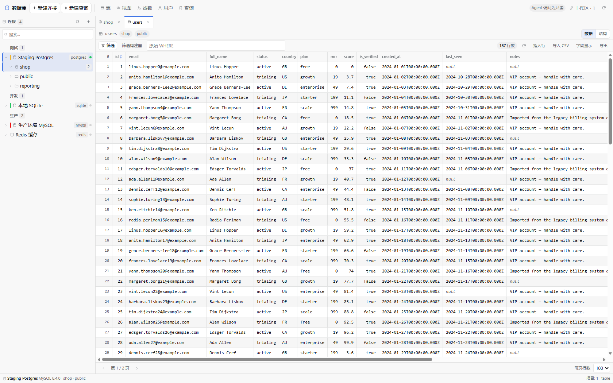
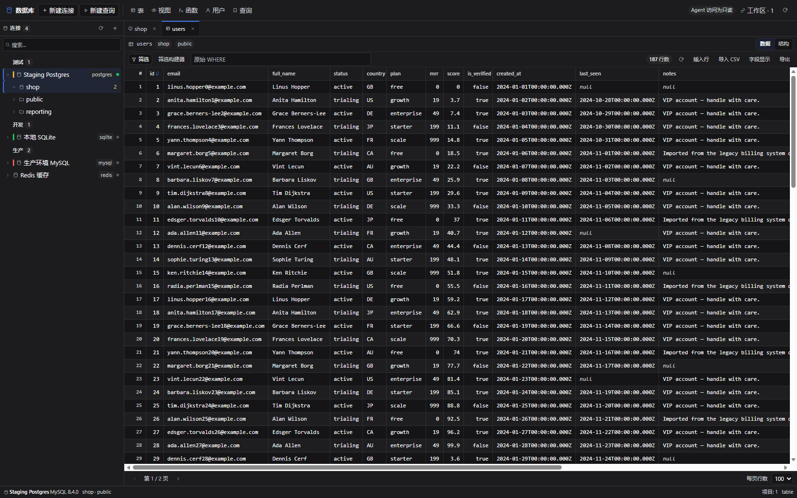
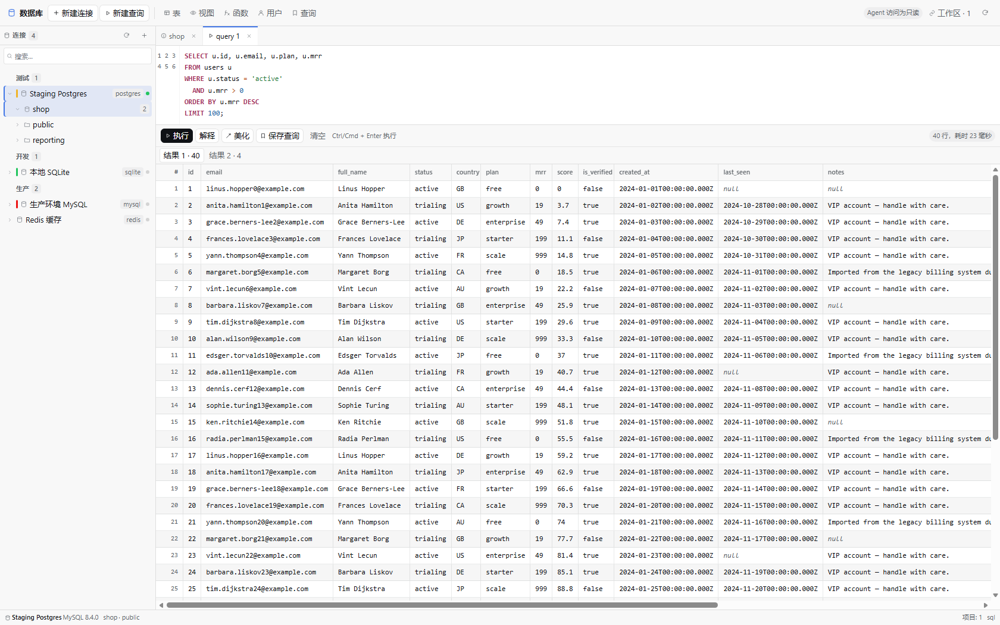
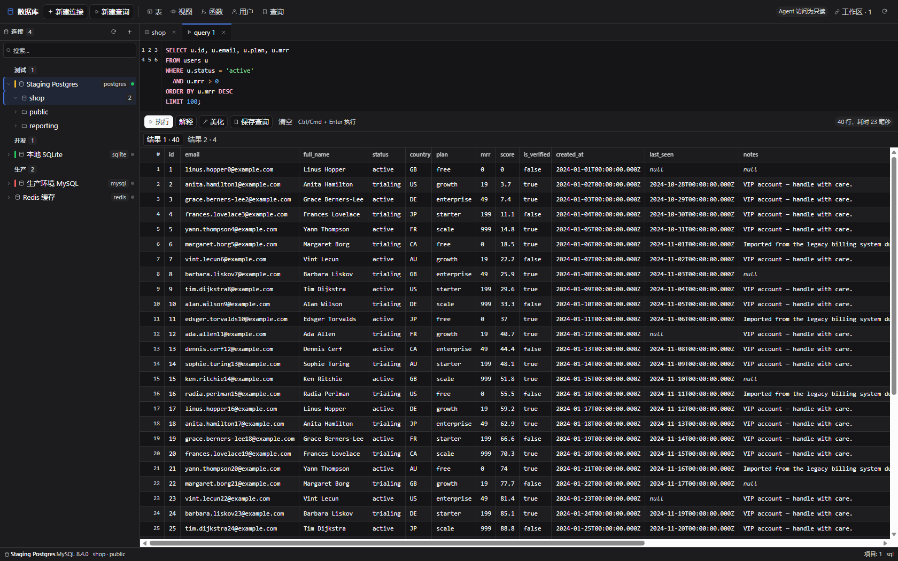
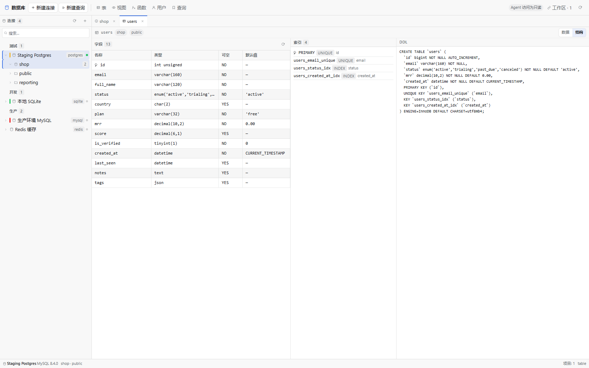
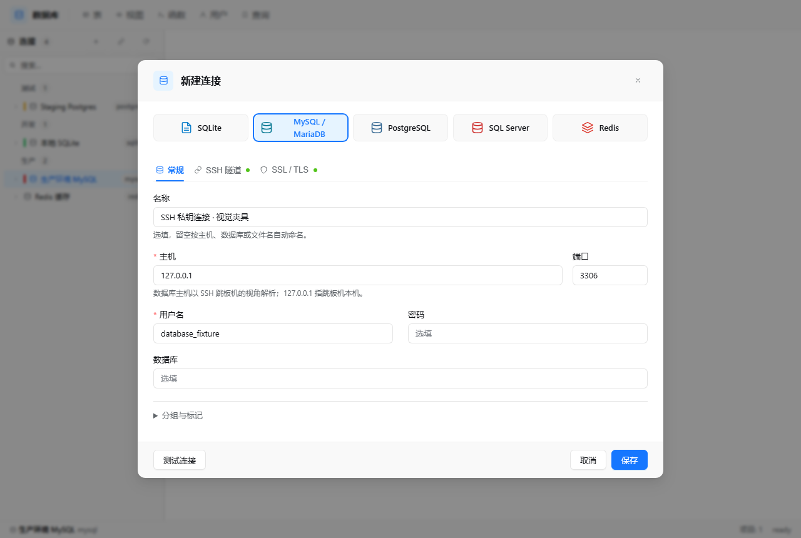

# Grid user guide

[Documentation index](<README.md>) · [Development](<development.md>) · [Security boundaries](<security.md>)

## Screenshots

Both themes are rendered from the same declarations — a `--dg-*` layer over the host tokens — so dark
mode is not a separate skin that drifts.

| Light | Dark |
| --- | --- |
|  |  |

The SQL console takes its syntax colours from the host's own highlighter palette, pulled toward the
text colour so strings and comments stay readable on white as well as on near-black:

| Light | Dark |
| --- | --- |
|  |  |

| Structure of a relation | New connection |
| --- | --- |
|  |  |

These are produced by `dev/cdp-shot.mjs` (see [Development](<development.md>)); `pnpm audit:ui` measures
the same views for contrast, surface separation and target sizes instead of photographing them.

## Install

```powershell
dsh plugin add <absolute-path-to-this-repository>
```

Or from the Plugin Manager: **Install bundle** → choose this directory. Then reload the page and
open the **数据库 / Grid** entry in the sidebar.

To let the agent modify data, edit the row in your profile's `cordis.patch.yml`:

```yaml
- insert:
    - id: grid
      name: '@local/dsh-grid'
      config:
        allowWrites: true    # default false
        idleMinutes: 10      # close an idle session after N minutes
```

`allowWrites` gates the **agent's** `grid_execute` tool. The panel itself always
lets you edit rows (it is you), while `grid_query` is read-only for the agent
regardless.

## Requirements

Node **22.13+** (or 23.4+) is required: SQLite goes through the built-in
`node:sqlite` module, which only stopped needing `--experimental-sqlite` at those
versions. The other four engines are optional dependencies, so a profile that
does without them still starts.

## Engines

| Engine | Driver | Status | Notes |
| --- | --- | --- | --- |
| SQLite | `node:sqlite` (built in) | ✅ out of the box | No install, no native build; queries run on a worker thread |
| MySQL / MariaDB | `mysql2` | ✅ optional dependency | 5.7+; table comments and row estimates |
| PostgreSQL | `pg` | ✅ optional dependency | 12+; database + schema levels, `reltuples` estimates |
| SQL Server | `mssql` | ✅ optional dependency | 2017+ |
| Redis | `ioredis` | ✅ optional dependency | 6+; namespaces, TTL, rename, console |
| Oracle, DB2 / ODBC | — | ⛔ not yet | Needs Instant Client / ODBC |

The four network drivers are declared as `optionalDependencies` and imported lazily. If one is
missing, only that engine reports *"the MySQL driver is not installed"*; everything else keeps
working. Install it with `pnpm add mysql2` inside the plugin directory.

## The panel

Three columns, the way a desktop client is laid out:

```
┌ toolbar ───────────────────────────────────────────────────────────────┐
│ Grid  [+ New] │ ● 生产环境 MySQL  mysql │ ⏻ ✓ ✎ 🗑 │      [New query] [⟳] │
├────────────┬──────────────┬────────────────────────────────────────────┤
│ 连接        │ 对象          │ tabs: users · Query 1 · Redis db0          │
│ ▾ 生产      │ audit_log    │ ┌────────────────────────────────────────┐ │
│   ● MySQL  │ categories   │ │ data grid / SQL console / structure    │ │
│   ○ Redis  │ orders       │ └────────────────────────────────────────┘ │
│ ▸ 测试      │ users        │                                            │
├────────────┴──────────────┴────────────────────────────────────────────┤
│ ● 生产环境 MySQL  8.4.0 · shop · 13 objects                    ready     │
└────────────────────────────────────────────────────────────────────────┘
```

**Connections** — create, edit, delete, test, connect, disconnect; group label, environment colour,
TLS mode. Groups collapse; right-click a connection for the full menu.

The connection dialog prefers **840px** and fits smaller viewports. Host/port and user/password
are grouped on shared rows, with long file paths, SSH fingerprints and private keys using the
full width. On narrow screens the main grid stacks into one column. Network engines retain
separate General, SSH and SSL/TLS tabs; SQLite only shows file-related fields.

**Name** is optional in the panel: leave it blank to generate a name from the host/database or
the SQLite filename. **Organization / 分组与标记** contains the optional group and environment
colour, collapsed for new connections and expanded when editing existing non-default values.
Collapsing it or switching tabs does not discard drafts or change saved credentials.

**TLS modes** — `disable` (default), `require` (encrypted, certificate *not* verified),
`verify-ca` (chain verified) and `verify-full` (chain and host name). A connection created with
`ssl: true` is treated as `verify-full`; supply `options.sslCa` with a PEM string to trust a
private CA. **TLS server name** optionally specifies the database certificate identity while
leaving the physical database address unchanged. SQL Server does not support chain-only
`verify-ca`: choose `verify-full` or another supported mode. MySQL `verify-full` requires a
DNS certificate identity; when dialing an IP, supply that DNS name explicitly.

## SSH tunnels

Network connections support a **single SSH jump host** with password or OpenSSH private-key
authentication (including an encrypted private key's passphrase). SQLite remains a local file
connection. No shell commands, agent forwarding or system `ssh` process are used.

1. Enter the **database host and port as reachable from the jump host**. An internal DNS name is
   resolved there; `127.0.0.1` means the jump host itself, not the browser or the DSH machine.
2. Enable **Connect through SSH**, then enter the jump host, port (default 22), user and authentication method.
3. Supply the **pinned SHA256 SSH host fingerprint** obtained from the administrator through a trusted channel.
   On the SSH server, an administrator can inspect a host public key with:

   ```sh
   ssh-keygen -lf /etc/ssh/ssh_host_ed25519_key.pub -E sha256
   ```

   Copy the `SHA256:...` value for a key type the server will negotiate. Grid never discovers or
   accepts keys automatically. A mismatch stops the connection; verify a legitimate rotation
   out of band before updating the pin. Only one pinned host key is supported per connection.
4. Enter the SSH password, or paste the complete private key and optional passphrase. There is no
   arbitrary Host file-path reader. Test the connection, then save it.
5. Keep database TLS configured independently. SSH protects DSH → jump host; it does **not** protect
   the jump host → database leg. The TLS server name is the **database** identity, not the SSH host.

The jump host must permit local TCP forwarding and reach the database endpoint. An administrator
can restrict a dedicated account using `AllowTcpForwarding local` and `PermitOpen host:port`.
The DSH Host, not the browser, must be able to reach the jump host.

`ssh2` is an optional, lazily imported dependency. If absent, only SSH connections fail; direct
connections keep working. Install it from the plugin directory with `pnpm install --ignore-scripts`.
The core JS path works without the package's optional native acceleration/build scripts.

**Credential edits:** blank fields preserve saved credentials; the explicit **Clear credential**
action removes one. Disabling SSH and saving erases its settings and secrets. Switching authentication
methods erases the obsolete method's credentials. Passwords, private keys and passphrases are independently
AES-256-GCM sealed; neither plaintext nor ciphertext is returned to the browser or Agent.
Omission preserves a credential in API patches and draft tests; an explicit empty string clears it.

**Lifecycle:** main/query drivers share one SSH connection per saved configuration, but each driver
owns its own ephemeral `127.0.0.1` listener. Each TCP connection gets a separate SSH channel, including
MySQL/PostgreSQL cancellation connections and SQL Server pool connections. Draft tests are isolated.
Closing an idle lane does not kill another lane. Disconnect/edit/delete invalidates old queued and
pending work; unload aborts probes and transport handshakes. A 20-second total connect deadline covers
SSH and database setup, followed by bounded cleanup. Cancellation is bounded at 10 seconds.
SSH-level keepalives run every 15 seconds, with three unanswered probes tolerated.

A dropped SSH connection invalidates its sessions. **An in-flight operation is not replayed**, even
if it returns a per-statement error; its outcome may be unknown. A later request reconnects on demand.
Grid never silently falls back to a direct connection. The existing Agent write policy is unchanged.

**Threat boundary:** loopback ports are not a local-user authentication boundary. Other processes
on the same Host can reach the forwarding listener while it is open, so retain database authentication
and use a trusted single-user Host or OS/container isolation. Sealing credentials does not protect
against an attacker who controls the Host account and can also read its encryption key. Enforce
appropriate Windows ACLs; POSIX `0600` alone is not an equivalent Windows access-control guarantee.

First-version exclusions: multi-hop/ProxyJump/ProxyCommand, interactive MFA, SSH agent/hardware-key
integration, Redis Cluster/Sentinel, and SQL Server instance discovery or redirected endpoints.
Configure a fixed TCP endpoint; redirects are rejected instead of bypassing the tunnel.

## The data views

**Object list** — the relations of the selected database with **name, kind, estimated rows and
comment**, sortable by any column and searchable. Double-click opens a tab; right-click offers
data, structure, "open in query" and copy-name.

**Data grid**

- server-side pagination and click-to-sort that stays correct across pages;
- the pager shows the row total from the engine's own estimate (`≈`) for an unfiltered table, and
  counts exactly when you filter or press **Refresh** — a `COUNT(*)` over a large table costs more
  than the page it labels;
- **Excel-style selection**: click, drag, or `Shift`+arrows to extend; `Ctrl/Cmd+C` copies the
  selection as TSV, `Ctrl/Cmd+V` pastes it back (multi-row paste asks for confirmation);
- the pager shows **selection size, sum and average** of the selected numeric cells;
- double-click a cell to edit it in place; the **row-number cell** opens a row editor with every field at
  once (only the fields you changed are written back, one `UPDATE` by primary key; text, JSON and long
  `varchar` columns get a multi-line field); **Insert row** adds a row of column defaults, ready to fill
  in, and the trash button deletes the current row;
- **column resize** by dragging header edges, **column hide/show** from the Columns menu (local, no
  refetch);
- a **filter builder** (column / operator / value with AND-OR, plus a raw `WHERE` escape hatch);
- insert row, delete row, and an **Export** menu — CSV, JSON, `INSERT` statements, or a Markdown table.
  The export walks the whole table page by page and says so when it stops at the 10 000-row limit.
- **Import CSV** — the header must name columns this table has (a stray column is refused rather than
  dropped). Rows go in 200 at a time and each batch is one transaction: a bad row rolls back
  that batch, but earlier batches may already be committed. An empty cell is written as explicit
  `NULL`, **not** `DEFAULT`; a NOT NULL column may therefore reject it.

Editing needs a primary key: without one a row cannot be addressed safely, so the grid says so and
refuses the edit instead of risking a full-table update.

**Structure** — columns with type, nullability, default and PK marker; indexes; DDL. The description is
fetched once per open table and shared with the data view, so toggling Data/Structure costs no round
trip; each view's Refresh asks for a new one. On PostgreSQL the DDL is assembled from the catalogue —
real types, identity and generated columns, constraints as separate `ALTER TABLE` statements (so a
deferrable constraint survives), non-constraint indexes and comments; on SQL Server the `sys.*`
equivalents including computed columns and named default constraints, rendered with the exact type
(`nvarchar(100)`, `decimal(18, 2)`, `nvarchar(max)`). A view shows its own definition instead of a
synthesised `CREATE TABLE`.

**SQL console**

- **syntax highlighting** (keywords, functions, strings, numbers, comments, variables) drawn under a
  transparent textarea, with a **line-number gutter**;
- **completion** for keywords, functions, the tables in the current database and the columns of the
  open tab; `Ctrl+Space` opens it, arrows navigate, `Enter`/`Tab` accepts;
- `Ctrl/Cmd+Enter` runs the selection or the whole script; `Tab` indents; **Beautify** reformats
  clause by clause without touching the contents of strings or quoted identifiers; **Explain**
  prefixes the first statement;
- while a script runs, **Cancel** asks the engine to stop it (PostgreSQL `pg_cancel_backend`, MySQL
  `KILL QUERY`, SQL Server request cancel). SQLite has no interrupt API, and says so instead. A
  cancel travels on its own control path, so it is not queued behind the statement it stops;
- one result tab per statement, per-statement timing, a 25-entry **history** menu, and a banner when
  the result was capped at 2 000 rows.

**Redis** — namespace-grouped keys (`user:`, `cart:`, …), type filter, per-type value views
(string / hash / list / set / zset / stream), TTL, rename, edit string value, new key, delete, and a
raw command console.

The layout is a flex column and both toolbars **wrap** rather than clip. On a narrow panel the
buttons can move to a second line. See [browser validation](<testing.md#浏览器量具>) for reproduction
commands and coverage limits; older measurements are preserved as historical records, not a
permanent layout guarantee.

## Agent tools

| Tool | Purpose | Writes |
| --- | --- | --- |
| `grid_list_connections` | Connections, engines, open sessions (no passwords) | — |
| `grid_inspect` | Databases / schemas / tables, or one table's columns, indexes and DDL | — |
| `grid_query` | Read-only SQL (`SELECT`, `WITH … SELECT`, `SHOW`, `DESCRIBE`, `EXPLAIN`, `PRAGMA`) | no |
| `grid_execute` | Any SQL, including DDL/DML | only with `allowWrites: true` |
| `grid_save_query` | Save a named query for later use in the Queries list or `grid_query` | saves query metadata; never executes SQL |

`grid_query` classifies every statement before running it and rejects known mutating forms.
This is a guard, not a complete SQL sandbox: use a least-privilege database login and read the
[security boundaries](<security.md>). The classifier masks string literals and comments
first, refuses `EXPLAIN ANALYZE` (which executes its statement), `SELECT … INTO` / `INTO OUTFILE`,
`FOR UPDATE` / `FOR SHARE`, and a `PRAGMA name = value` assignment.

That is only the first layer. A read-only run is also handed to the engine, which refuses the write
itself: PostgreSQL runs it in `BEGIN READ ONLY`, MySQL in `START TRANSACTION READ ONLY`, and SQLite
sets `PRAGMA query_only`. SQL Server has no read-only session or transaction, so there the classifier
and the login's own permissions are the boundary.

`grid_query` and `grid_inspect` may omit `connectionId` when the workspace is bound to a database in
the panel — the binding supplies both the connection and its database.

## Sessions

A connection keeps **two**: the workbench lane serves the object tree, a page of rows and the
structure view, while SQL you type (and an export) runs on a second lane of its own. A report that
takes thirty seconds no longer freezes the rest of the panel, and Cancel has a connection it can
reach. SQLite and SQL Server stay on one connection — SQLite's driver is synchronous, and `mssql`
already multiplexes its own pool. Sessions expire after `idleMinutes` (default 10).

## Data and security

- Connections live in `$DSH_HOME/dsh-grid/connections.json`.
- Passwords are sealed with **AES-256-GCM** under a random key in `$DSH_HOME/dsh-grid/key`
  (mode `0600`), stored in its own file beside the registry.
- A password is **never** returned to the browser or to a tool: projections carry only
  `hasPassword`.
- The browser talks to `POST /api/grid` through `ctx.connection.fetch`, authenticated by the
  same-origin browser peer.
- Row updates and deletes always require a primary key, so a misclick cannot rewrite a table. The
  Host also checks the posted key against the table's real primary key, so a crafted or stale
  request cannot turn one row write into a full-table update.
- A read-only run is guarded twice. The classifier rejects PRAGMA write forms as well as `=`
  assignments, and SQLite re-asserts `PRAGMA query_only` before every statement, so a script cannot
  disable the guard for the statements that follow it.
- Redis scoped operations re-select the requested logical database instead of trusting the
  session's cached index, because a raw `SELECT` in the console moves the shared connection.
  Raw commands and key deletion are never retried after a dropped connection.
- When TLS is enabled, certificate verification is the default; `require` is the explicit
  unverified opt-out. TLS itself is not enabled by default (`disable`).
- Connection handshakes have a 20s total deadline for transport + driver setup, with bounded
  graceful cleanup and forced socket teardown after a 1s grace period.
- Statements are bounded too: `options.queryTimeoutMs` (default 30 000) becomes
  `statement_timeout` on PostgreSQL, `MAX_EXECUTION_TIME` / `max_statement_time` on MySQL and
  MariaDB, `requestTimeout` on SQL Server and `commandTimeout` on Redis. SQLite has no equivalent, so
  a runaway SQLite query is bounded only by the client giving up.
- Writes are never retried automatically: a dropped socket after a committed `INSERT` would
  otherwise be replayed. Only all-reads scripts get the one retry.

## Known limits

- Oracle and ODBC engines are not implemented.
- No SOCKS5 or HTTP proxy. SSH is single-hop TCP forwarding only (see above).
- No table designer (create/alter table), no schema comparison, no backup/export container.
- PostgreSQL and SQL Server sessions are bound to one database; switch it by editing the connection.
- The grid pages instead of virtualising, so it stays simple at the cost of very large scans.
- Redis key enumeration is `SCAN`-based, so a huge keyspace is paged rather than listed at once.
- No cancel on SQLite, and no cancel for an engine that refuses the side connection: the statement
  then runs to its timeout instead.
- Import is CSV only (no Excel), and the file's header must already match the table's column names.
- On engines with one connection per lane (SQLite, SQL Server) a long query still delays other
  actions on that connection.
- A `SELECT` from the console or the agent stops at 2 000 rows and says it was truncated. MySQL and
  SQL Server stream, so the rest never enters the Host's memory; PostgreSQL still materialises the
  result first, because bounding it there needs a cursor dependency.
- `node:sqlite` is synchronous, so it runs on a worker thread; in the rare environment where a worker
  cannot be started the driver falls back to in-process and a heavy query then blocks the Host.
- Structure DDL is an inspection aid, not a complete schema dump: PostgreSQL and SQL Server can
  return view definitions, but triggers and extended properties are not comprehensively exported.
  MySQL table DDL uses `SHOW CREATE TABLE` verbatim.
